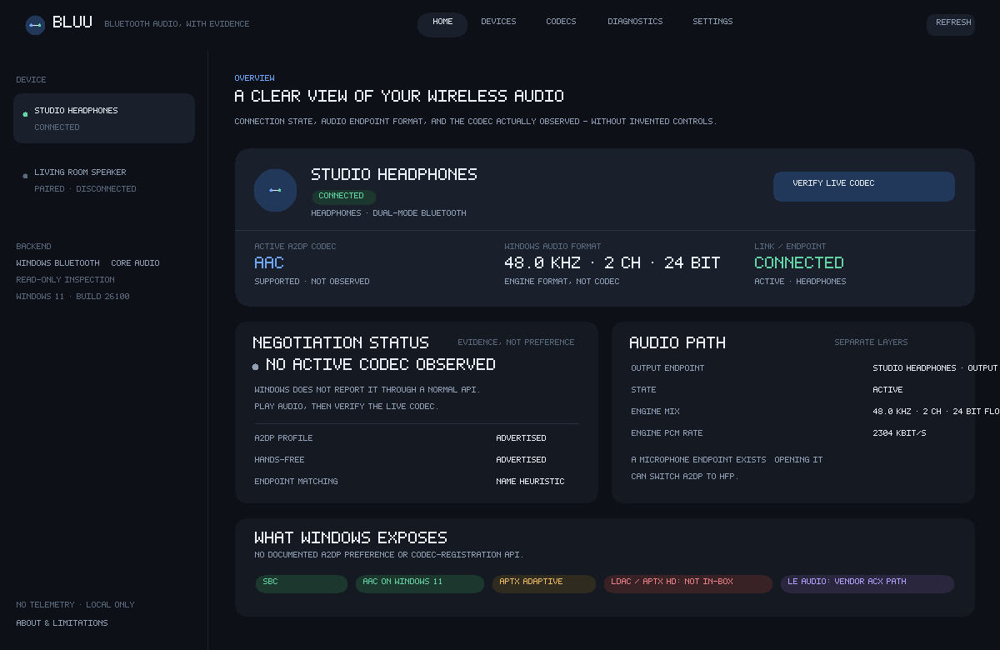

# Bluu

**Bluetooth audio, with evidence.**

Bluu is an open-source Windows 11 (and documented Windows 10) Bluetooth audio
diagnostics and codec-management application. It answers what is actually happening
without pretending Windows offers controls it does not.



## What it does

- Discovers paired and connected Bluetooth audio devices.
- Reads connection state and cached A2DP/HFP profile records.
- Shows Windows audio endpoints, shared-mode format, mix format, and engine period.
- Separates codec **capability**, **configuration**, **negotiation**, and
  **independent verification**.
- Observes the codec Windows actually negotiated using an optional, short-lived,
  elevated ETW helper.
- Explains unavailable codecs instead of offering fake toggles.
- Exports local, redacted diagnostics.

## What it deliberately does not do

- It does **not** silently install drivers or replace the Bluetooth stack without
  explicit consent. The optional Bluu native A2DP provider is a separate experimental
  component with its own installer, signing, test-signing, and rollback procedure.
- It does **not** disable Secure Boot or driver signature enforcement. A test-signed
  driver is not presented as production-ready.
- It only writes the build-sensitive `BthA2dp\Parameters\BluetoothAacEnable` value
  through a separate elevated helper after an explicit warning, a dry-run check when
  requested, backup of the prior value, and a documented restore path.
- It does **not** claim that a codec library adds Windows A2DP support.
- It does **not** show a codec as active because it is selected in the UI.
- It does **not** universally unlock LDAC, aptX HD, or aptX Adaptive.

Windows exposes no documented A2DP codec preference or codec-registration API. On a
generic PC, advanced codec support requires a vendor/OEM stack, an external dongle, or
a replacement driver — not a registry tweak. See [research](docs/RESEARCH.md) and the
[codec matrix](docs/CODEC-MATRIX.md).

## Codec honesty at a glance

| Codec | Generic Windows 11 in-box A2DP | Set preference in Bluu |
|---|---|---|
| SBC | Yes | No documented preference API |
| AAC | Yes (21H2+) | One opt-in BthA2dp value, backed up |
| aptX Classic | Yes | Indirectly, by disabling AAC on affected builds |
| aptX HD | No | Native experimental provider / provider-gated |
| aptX Adaptive | Select Qualcomm 24H2 devices | Provider-gated / OEM |
| LDAC | No | Native experimental provider / provider-gated |
| LC3 / LE Audio | Separate vendor LE Audio path | Not an A2DP provider codec |

Bluu shows what it can observe and explains the rest.

## Install (portable)

1. Download the release ZIP or build from source.
2. Keep `bluu.exe` and `bluu-etw-helper.exe` in the same folder.
3. Run `bluu.exe` as a normal user.
4. Pair/connect the headset in Windows Settings.
5. Use **Verify live codec** only when you want to approve a one-time elevation
   prompt for the ETW helper. Advanced codec control requires an explicitly
   installed provider; see [provider API](docs/PROVIDER-API.md) and the
   [native component limitations](docs/NATIVE-A2DP.md).

The portable build does not install a driver or service. Installing the optional
native A2DP driver/service is a separate, explicit, administrator-approved action.

## Build from source

Requirements:

- Rust 1.88+ (the repository pins 1.88.0)
- Windows 10/11 with the MSVC target and Visual Studio Build Tools for a real Windows
  executable
- For a non-Windows demo build: a Rust host toolchain and graphics drivers

```powershell
cargo build --workspace --release
```

For a cross-target type-check from macOS/Linux:

```bash
rustup target add x86_64-pc-windows-msvc
cargo check --workspace --target x86_64-pc-windows-msvc
```

The Windows MSVC target needs the MSVC linker at link time; `cargo check` does not
link.

Run the demo on a non-Windows host:

```bash
cargo run -p bluu-app -- --demo
```

Generate the documentation images:

```bash
cargo run -p bluu-platform --bin screenshots
```

Package a portable Windows folder (run on Windows with both executables built):

```powershell
powershell -ExecutionPolicy Bypass -File packaging/windows/build-portable.ps1
```

## Architecture

```text
crates/bluu-core       domain, codec facts, diagnostics, SDP, privacy, settings
crates/bluu-platform   Windows + demo backends, screenshot fixture renderer
crates/bluu-app        egui desktop application
crates/bluu-etw-helper short-lived elevated ETW observer
crates/bluu-provider-demo simulated provider protocol fixture
crates/bluu-provider-owb adapter for the optional native A2DP provider
native/owb             GPLv3 experimental A2DP driver/service and codec components
```

See [architecture](docs/ARCHITECTURE.md), [security](docs/SECURITY.md), and
[testing](docs/TESTING.md).

## Testing status

On the development host (macOS, no Windows radio):

- 54 Rust workspace tests pass (31 core, 9 platform, 3 app, 4 provider-contract,
  7 native-provider adapter);
- 51 native AVDTP/packet/receive-queue host tests pass;
- formatting and Clippy with `-D warnings` pass;
- the Windows target type-checks;
- the demo UI/screenshot renderer builds;
- the provider apply/verify/rollback protocol is exercised end-to-end against a
  simulated provider.

Run the same local gate with:

```bash
sh scripts/check.sh
```

**No Windows hardware validation has been claimed.** The hardware matrix in
[docs/TESTING.md](docs/TESTING.md) is intentionally pending. Real-device acceptance
requires a Windows machine, a Bluetooth radio, and headphones.

## Privacy

Bluu is local-first: no account, telemetry, cloud dependency, or automatic uploads.
Diagnostic exports are local JSON and redact device names, addresses, endpoint IDs,
usernames, computer name, and paths by default. See the
[privacy policy](PRIVACY.md) and [technical notes](docs/PRIVACY.md).

## Licence

GPL-3.0-or-later, with the vendored third-party components retaining their
respective licences. See the [licence summary](LICENSE.md) and
[licensing details](docs/LICENSING.md). Product names and trademarks belong to
their respective owners.
